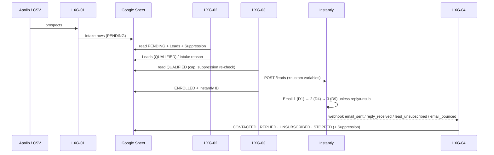
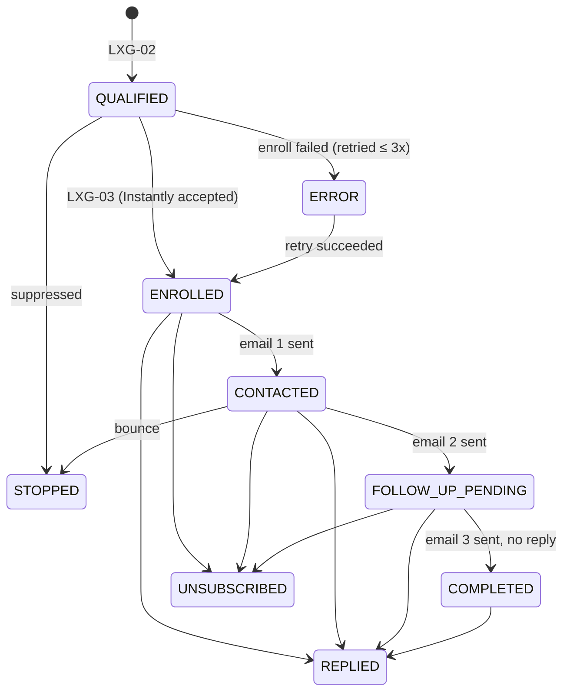

# Architecture

## Components and responsibilities

| System | Owns | Does **not** do |
|---|---|---|
| **Apollo** | prospect discovery, contact data, email verification status | sending, tracking |
| **n8n** | orchestration: intake, qualification, de-dupe, enrollment, event handling, reporting, monitoring | sending email, timing follow-ups, writing copy |
| **Instantly** | email copy, sending, warm-up, Day 1/4/9 timing, reply detection, stop-on-reply, unsubscribe link, campaign metrics | lead sourcing/filtering |
| **Google Sheets** | business-level record + queues between workflows | heavy analytics |

## Data flow

## Lead status model

`REPLIED`, `UNSUBSCRIBED`, `STOPPED` are **terminal**: later (out-of-order) "email sent" events never overwrite them,
and LXG-03 only ever picks `QUALIFIED` (or retryable `ERROR`) leads. `NEW` is reserved (unused in the pilot).
`COMPLETED` is an addition to the brief's list: "all 3 emails sent, no reply".

## Key design decisions

1. **The sheet is the queue.** LXG-01 → *Intake* → LXG-02 → *Leads* → LXG-03. No workflow calls another, so there are
   no workflow-ID dependencies at import time, every stage can be run/paused/retried alone, and the owner can see every
   record and why it was rejected. Writes are ordered so a crash is recoverable: the lead row is appended *before* the
   Intake row is marked done; LXG-02 recognises a half-finished lead (`RECOVERED_ALREADY_IN_LEADS`) instead of duplicating it.
2. **Instantly does everything it already does.** n8n never schedules follow-ups. Stop-on-reply is Instantly's native
   campaign setting; n8n's job is to *record* it and make sure n8n itself never re-enrolls the contact.
3. **Belt and braces on suppression.** Checked in LXG-02 (before a lead exists), again in LXG-03 (right before enrolling),
   and `skip_if_in_workspace` is set on the Instantly call. Unsubscribe/bounce events write the Suppression tab *before*
   the lead row. A reply asking to stop ("unsubscribe", "remove me", …) is handled as an unsubscribe by a simple keyword
   rule — deliberately not AI classification.
4. **Failures are loud, retries are bounded.** Node-level retry ≤3 (API/Sheets calls); enrollment failures are retried by
   later runs ≤ `MAX_ENROLL_ATTEMPTS`, then stay `ERROR` for a human. If *every* enrollment in a run fails, the run is
   failed on purpose so the Error Handler emails the owner. LXG-99 logs to the sheet first, emails second, and never retries.
5. **Independent monitoring.** LXG-06 uses the n8n API (not the workflows' own claims) to find stale, failing, inactive or
   missing workflows, and optionally pings an external dead-man's-switch so an outage of n8n itself is also noticed.
6. **Dry-run by default** (`DRY_RUN=true`): enrollment and acknowledgements are logged, not executed.
7. **Adapter pattern for Apollo.** LXG-01 produces one canonical lead shape from either the Apollo API or CSV. Nothing
   downstream knows which was used. Add another source by emitting the same shape before *Build Intake Rows*.
8. **No PostgreSQL.** n8n's built-in SQLite holds workflow/execution data; the Sheet holds business data. Revisit
   Postgres only if you move to queue-mode/multiple workers, or the Sheet becomes too large (see scaling).

## Implementation notes for maintainers

* **Never write an expression that references a Code node, e.g. `{{ $('Decide Action').first().json… }}`.**
  On n8n 1.123 this throws "could not be cloned" (found in live testing; referencing Set/other nodes works, and `$()` *inside
  Code nodes* works). The workflows pass data via `$json` and use small **Restore** Code nodes to re-attach data after Sheets
  writes. `tests/run-logic-tests.js` fails if an expression does this.
* Branch order in n8n (v1 execution order) is sequential, not parallel — anything that can fail must not sit in front of
  something that must always happen (see LXG-99 and LXG-06 wiring).
* Sheets nodes use explicit column mapping ("define below") and write only the columns they own, so concurrent workflows
  never blank each other's columns. Dates are ISO-8601 UTC strings (`cellFormat: RAW`).
* The Instantly `step` in webhooks is 1-based (verified in Instantly's docs); `STEP_OFFSET` in LXG-04 *Normalize Event* exists if that ever changes.

## Scaling to 300–500+ leads/week

* ~70–100 enrollments/day is ≈ 100 Sheets API calls/day for updates plus a few reads per run — far below Google quotas.
  The per-lead `update` calls are the main load; if you reach several thousand/day, batch them or move Leads to a DB.
* The Leads tab is fully read by LXG-02/03 each run. Fine to ~20–30k rows (≈ 1 year at 500/week). Beyond that: archive old
  rows to a second sheet, or introduce PostgreSQL for Leads/Suppression (swap the Sheets read/write nodes; Code nodes stay).
* Volume is bounded by sending capacity, not n8n: add mailboxes/domains in Instantly (rule of thumb: ≤ 30–40 cold emails
  per mailbox per day ⇒ 500 leads/week × 3 emails ≈ 1,500 emails/week ≈ 300/day ⇒ ~8–10 mailboxes at full ramp).
  Use `DAILY_ENROLL_CAP` / `APOLLO_MAX_PER_RUN` to ramp.
* Multiple campaigns: `INSTANTLY_CAMPAIGN_MAP` routes by segment (golf, clubs, equestrian, …).

## Expansion: Western Europe / United States

* Add countries to `ALLOWED_COUNTRIES` and `person_locations` in LXG-01 *Config*.
* Revisit title keywords (add local-language equivalents of buyer/owner/director) in LXG-02's CONFIG block.
* Legal regimes differ by country (consent rules, B2B vs consumer, mandatory sender details) — client's responsibility.
* Consider per-region campaigns/domains via `INSTANTLY_CAMPAIGN_MAP` (add a `Region` segment in the qualifier if needed).
