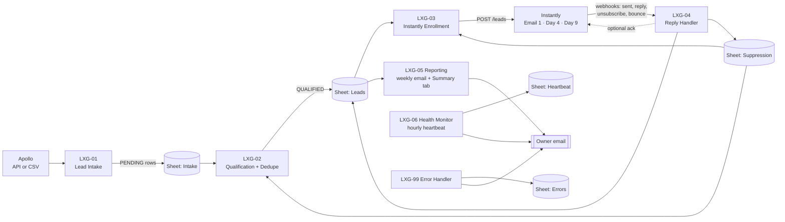

# LXG Society — Cold Outreach Automation (Pilot)

Apollo finds wholesale prospects → **n8n** qualifies, de-duplicates and enrolls them → **Instantly** sends a 3-email
sequence (Day 1 / 4 / 9) → replies and unsubscribes stop the sequence → **Google Sheets** shows the business view.
Failures email the owner instead of silently stopping.

> This is a technical tool. It does **not** guarantee inbox placement, replies, revenue, or legal compliance
> (GDPR / PECR / CAN-SPAM etc.). It provides technical safeguards (unsubscribe handling, suppression list,
> stop-on-reply). Final compliance responsibility rests with the client.

## 1. Architecture



The Google Sheet is also the **hand-off queue** between workflows (Intake → Leads → statuses), so each workflow is
independent, restartable, and visible. See [ARCHITECTURE.md](ARCHITECTURE.md).

## 2. What each workflow does

| n8n workflow | Trigger | What it does |
|---|---|---|
| **LXG - 01 - Apollo Lead Intake** | weekdays 07:00 + manual | Gets prospects from Apollo (API adapter) **or** a CSV in `./import`, writes them to the **Intake** tab as `PENDING`. Skips ones already ingested. Capped per run. |
| **LXG - 02 - Lead Qualification** | every 2 h + manual | Filters (UK, verified email, decision-maker title, target business type, excludes fast-fashion/discount/etc.), de-duplicates (email, then domain+name), checks the suppression list. Qualified → **Leads** as `QUALIFIED`; others get a reason on the Intake row. |
| **LXG - 03 - Instantly Enrollment** | every 30 min + manual | Adds `QUALIFIED` leads to the right Instantly campaign with personalization variables, within a daily cap. Sets `ENROLLED`. Retries failures ≤3 times, then leaves `ERROR`. **Dry-run by default.** |
| **LXG - 04 - Reply Handler** | webhook from Instantly | `email_sent` → CONTACTED / FOLLOW_UP_PENDING / COMPLETED; `reply_received` → REPLIED (+ optional acknowledgement); `lead_unsubscribed` or a reply saying "unsubscribe/stop" → UNSUBSCRIBED + suppression; `email_bounced` → STOPPED + suppression. |
| **LXG - 05 - Reporting** | Mondays 08:00 + manual | Weekly summary email (leads added/enrolled/contacted, emails sent, replies, unsubscribes, errors, active campaigns, workflow health) and refreshes the **Summary** tab. |
| **LXG - 06 - Health Monitor** | hourly + manual | Reads each workflow's last success/failure from the n8n API, writes the **Heartbeat** tab, emails an alert if something is inactive, failing, stale or missing. |
| **LXG - 99 - Error Handler** | any workflow error | Logs the error (workflow, execution ID, failed node, message, lead ID) to **Errors** and emails the owner. No retry loops. |

## 3. Required services

| Service | Used for | Cost note |
|---|---|---|
| A small Linux server (VPS) with Docker | runs n8n (+ Caddy for HTTPS) | ~£5–10/month; any 1–2 GB VPS is enough |
| Apollo (paid plan) | prospect discovery + verified emails | API access depends on plan → CSV fallback supported |
| Instantly | sending, warm-up, sequence timing, reply detection | required |
| Outreach domain + mailboxes | sending (**not** lxgsociety.com) | see [docs/domain-mailbox-setup.md](docs/domain-mailbox-setup.md) |
| Google account | Google Sheet + OAuth for n8n | free |
| An SMTP account for *alerts/reports* | owner emails | free (e.g. a Gmail/Workspace app password); not a cold-outreach mailbox |

No PostgreSQL, no extra paid SaaS. (Optional free uptime ping: healthchecks.io.)

## 4. Configuration & credentials

* **Behaviour** (caps, countries, dry-run, campaign ids…): `.env` — documented line-by-line in [.env.example](.env.example).
* **Secrets** (Apollo / Instantly / Google / SMTP / n8n API keys): n8n **Credentials** (encrypted, never in files or the Sheet).
  Names the workflows expect:

  | Credential name in n8n | Type | Value |
  |---|---|---|
  | `LXG Google Sheets` | Google Sheets OAuth2 | sign in with the Google account that owns the sheet |
  | `LXG Instantly API` | Header Auth | Name `Authorization`, Value `Bearer <Instantly API v2 key>` |
  | `LXG Apollo API` | Header Auth | Name `x-api-key`, Value `<Apollo API key>` (only for API mode) |
  | `LXG n8n API` | Header Auth | Name `X-N8N-API-KEY`, Value `<key from n8n Settings → n8n API>` |
  | `LXG SMTP (alerts)` | SMTP | host/user/password of the alert mailbox |

Full walk-through: [SETUP.md](SETUP.md).

## 5. Starting, stopping, pausing

* **n8n → Workflows**: the toggle on each `LXG - …` workflow is the on/off switch. Turn **LXG - 03** off to stop all new enrollments instantly; turn **LXG - 01** off to stop new prospects.
* **Run now**: open a workflow → **Execute workflow** (the *Run manually* trigger).
* **Stop everything sent**: pause the campaign in **Instantly** (n8n only enrolls; Instantly sends).
* **After fixing an error**: open **Executions**, open the red run, fix the cause, then **Retry** or run the workflow manually.
* Server: `docker compose stop` / `docker compose up -d`. Data lives in the `n8n_data` volume.

## 6. Troubleshooting

See [TROUBLESHOOTING.md](TROUBLESHOOTING.md) (symptom → cause → fix).

## 7. Changing the email copy

Email copy lives **only in Instantly** (Campaigns → your campaign → Sequences). n8n never touches it. Personalization
variables available in copy: `{{firstName}} {{lastName}} {{companyName}}` and custom variables
`{{job_title}} {{industry}} {{business_type}} {{segment}} {{location}} {{city}} {{country}}`.
The optional reply acknowledgement text is the only copy inside n8n: *LXG - 04 → "Decide Action" node → `ACK_SUBJECT` / `ACK_BODY`*.

## 8. Changing Apollo targeting

* **API mode:** *LXG - 01 → "Config" node* (job titles, locations, keyword tags, employee ranges).
* **CSV mode:** build the search in Apollo's UI, export contacts to CSV, drop the file in `./import`.
* **Who is accepted after sourcing** (titles, business types, exclusions, countries, email status): *LXG - 02 → "Qualify & Dedupe" node* (CONFIG block at the top) and the `ALLOWED_*` variables in `.env`.
* Details: [docs/apollo-setup.md](docs/apollo-setup.md).

## 9. Checking campaign health

1. **Google Sheet → Summary** tab: funnel numbers, reply rate, errors, last successful run, workflow health.
2. **Google Sheet → Heartbeat** tab: one row per workflow with Health = `OK / FAILING / STALE / INACTIVE / MISSING`.
3. **n8n → Executions**: every run, with red for failures.
4. **Instantly → Analytics / Accounts**: sending volume, bounce rate, warm-up status, mailbox errors.
5. The Monday email, and instant alert emails for critical problems.

## Repository layout

```
README.md  SETUP.md  ARCHITECTURE.md  TROUBLESHOOTING.md  .env.example  docker-compose.yml  Caddyfile
workflows/   7 importable n8n workflow JSON files (the deliverable)
docs/        google-sheet-schema, apollo-setup, instantly-setup, domain-mailbox-setup, client-handover, 00-project-plan
sheet-template/  LXG-Outreach-Tracker.xlsx  (upload to Google Drive -> Open as Google Sheets)
scripts/     import, link error workflow, regenerate workflows/sheet template (see scripts/README.md)
src/         Code-node sources + sheet schema that the generator uses
tests/       offline logic tests, n8n validation, SCENARIOS.md (13 test scenarios), sandbox fixtures
import/      drop Apollo CSV exports here (CSV mode)
```

Run the tests: `node tests/run-logic-tests.js` (no credentials, no network, no emails).
